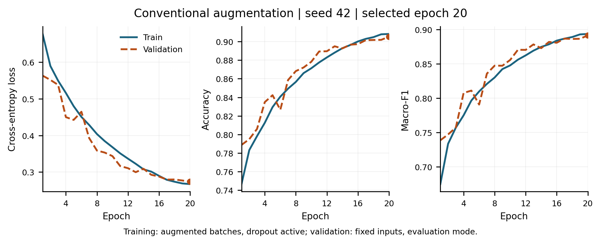

# Class-Adaptive Data Augmentation for Road Damage Classification

Research project investigating whether augmentation strength and transformation-family selection should adapt separately for each road-defect class during CNN training.

## Submission evidence

| Deliverable | Evidence |
| --- | --- |
| Literature synthesis, comparison table, and revised methodology | [Manuscript source](research_paper/main.tex), [BibTeX references](research_paper/references.bib), and the separately shared Overleaf manuscript |
| Prepared data splits | [Split documentation](dataset_splits_v1/README.md), [configuration](dataset_splits_v1/config.json), [summary](dataset_splits_v1/summary.json), `images.csv`, and `crops.csv` |
| Working baseline | [Verified results](reports/conventional_seed42_v1/analysis/RESULTS.md), [run configuration](reports/conventional_seed42_v1/config.json), logs, predictions, figures, and checkpoints |
| Reproducibility | Preparation and training scripts, [baseline runbook](BASELINE_RUNBOOK.md), [data audit](DATA_AUDIT.md), and dependency files |

### Initial baseline result

A randomly initialized 695,732-parameter CNN was trained for 20 epochs with seed 42. A shared fixed policy applies mild horizontal reflection, brightness, and contrast augmentation. Epoch 20 was selected by validation macro-F1.

| Validation metric | Result |
| --- | ---: |
| Accuracy | 90.52% |
| Macro-F1 | 0.8915 |
| Validation crops | 8,242 |

These are one-seed validation results. The held-out test partition has not been evaluated. The [per-class results](reports/conventional_seed42_v1/analysis/per_class_metrics.csv) and [confusion matrix](reports/conventional_seed42_v1/analysis/confusion_matrix.pdf) provide the class-level evidence.



## Task and data

The task is classification of annotated defect crops into longitudinal cracks (D00), transverse cracks (D10), alligator cracks (D20), and potholes (D40). It assumes a defect region is already localized and does not evaluate full-image detection.

| Partition | Source images | Crops |
| --- | ---: | ---: |
| Training | 16,624 | 38,513 |
| Validation | 3,573 | 8,242 |
| Test | 3,569 | 8,247 |

Crops from the same original image and connected near-duplicate candidates remain in one partition. Images are resized with aspect ratio preserved and padded to 224 by 224 pixels. Complete capture-sequence and location identifiers were unavailable, so geographic independence and the absence of every related view are not established. The padding also exposes bounding-box geometry; a [geometry-only diagnostic](reports/baseline_geometry_v1/README.md) documents this limitation.

Raw images and generated crop datasets are not included in Git. Obtain the RDD2022 archives from the [dataset authors](https://github.com/sekilab/RoadDamageDetector) or the [Figshare release](https://figshare.com/articles/dataset/RDD2022_-_The_multi-national_Road_Damage_Dataset_released_through_CRDDC_2022/21431547). Dataset citation: Arya et al., *RDD2022: A multi-national image dataset for automatic road damage detection*, Geoscience Data Journal, 2024, [doi:10.1002/gdj3.260](https://doi.org/10.1002/gdj3.260).

## Reproduce the prepared crops and baseline

The recorded training environment was Linux, Python 3.12.3, PyTorch 2.3.0 with CUDA 12.1, NumPy 1.26.4, Pillow 10.3.0, and an NVIDIA A10. Direct training dependencies are recorded in `requirements-training.txt`.

On CCAST, use the preinstalled environment from the [runbook](BASELINE_RUNBOOK.md). On another compatible Linux or Windows machine, create a separate Python 3.12 environment, activate it, and install:

```bash
python -m pip install torch==2.3.0 --index-url https://download.pytorch.org/whl/cu121
python -m pip install -r requirements-training.txt
```

The CUDA wheel selection follows the [official PyTorch version instructions](https://pytorch.org/get-started/previous-versions/#v230). CPU-only analysis uses a separate environment, described below.

Extract the seven source archives' `train` directories under `dataset/raw`, preserving paths such as `dataset/raw/India/train/images` and `dataset/raw/India/train/annotations/xmls`. The source directories are China_Drone, China_MotorBike, Czech, India, Japan, Norway, and United_States. Then run from the repository root:

```bash
python dataset_splits_v1/materialize_crops.py dataset/raw dataset_splits_v1/crops.csv dataset/processed_v1
```

This uses the frozen manifests and checks source-file hashes. Its output directory must be new. On an HPC system, run data processing and training inside the appropriate allocated compute job. Crop generation must finish before training begins.

First verify that the CNN can memorize a small training subset:

```bash
python -u train_baseline.py sanity --data dataset/processed_v1 --out runs/sanity_seed42_v1 --device cuda --steps 200 --seed 42
```

After `SANITY PASSED`, reproduce the conventional baseline:

```bash
python -u train_baseline.py train --data dataset/processed_v1 --out runs/conventional_seed42_v1 --device cuda --epochs 20 --batch-size 64 --workers 2 --threads 2 --seed 42 --augmentation shared --max-minutes 75
```

Use a new run directory for each experiment. The 75-minute stop is checked at epoch boundaries. Resume instructions and GPU allocation details are in the runbook. Exact numerical equivalence across software builds and hardware is not assumed.

## Inspect or regenerate the saved analysis without the dataset

The saved evidence under `reports/conventional_seed42_v1` includes configuration, environment, epoch histories, validation predictions, both baseline checkpoints, and a small training augmentation preview. The checkpoints are approximately 2.8 MB and 11.3 MB; they are intentionally included so the verification script can inspect the complete saved run. New training runs and other checkpoints are ignored by default.

To regenerate the verification report and plots, use a separate analysis environment. The recorded analysis used PyTorch 2.10.0+cpu, NumPy 2.4.2, and Matplotlib 3.10.8:

```bash
python -m pip install torch==2.10.0 --index-url https://download.pytorch.org/whl/cpu
python -m pip install -r requirements-analysis.txt
python summarize_baseline.py --run reports/conventional_seed42_v1 --manifest dataset_splits_v1/crops.csv
```

This checks the saved artifacts and regenerates files in the run's `analysis` directory. It does not load crop pixels, rerun inference, or evaluate the test partition. The exact training script and manifest are checked by SHA-256; `.gitattributes` preserves their bytes across Git checkouts.

## Source files

| File | Purpose |
| --- | --- |
| `audit_dataset.py` | Image/XML inventory and annotation checks |
| `validate_images.py` | Image decoding and exact-duplicate audit |
| `screen_near_duplicates.py` | Perceptual similarity screening |
| `make_splits.py` | Grouped allocation and crop-manifest preparation |
| `materialize_crops.py` | Crop generation from the frozen manifest |
| `train_baseline.py` | CNN, conventional policy, sanity check, training, and geometry diagnostic |
| `summarize_baseline.py` | Saved-run verification, metrics, and plots |
| `tests/` | Synthetic software checks for preparation and training behavior |

The generator copies in `dataset_splits_v1` are retained with the versioned preparation artifacts. To run the software checks in an environment with the required dependencies:

```bash
python -m unittest discover -s tests -v
```

These synthetic checks verify software behavior, not scientific model performance.

## Manuscript and next experiments

The manuscript uses the supplied IEEE template. Compile `research_paper/main.tex` with `research_paper/references.bib` in the same LaTeX project, using the IEEEtran BibTeX style. Overleaf supports this project structure. The shared Overleaf manuscript may be newer than this repository snapshot.

The [revised method protocol](research_paper/METHOD_PROTOCOL.md) describes the proposed class--family controller, fixed class-specific policy selection, component ablations, and evaluation plan. Those experiments, repeated seeds, and final held-out test evaluation remain future work.
