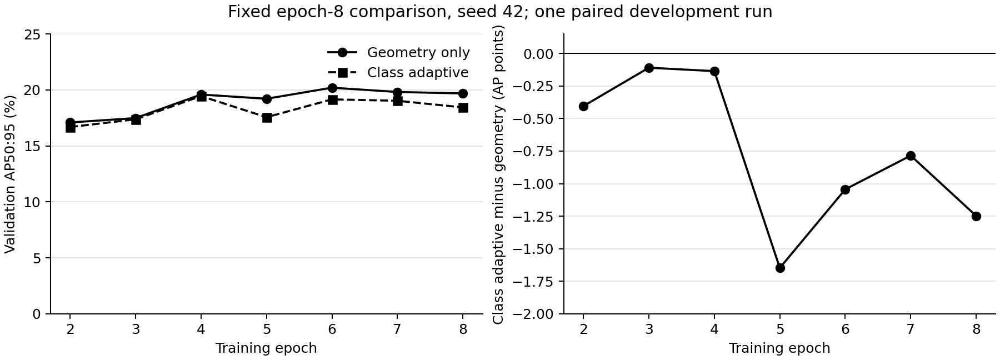

# RDD v2 paired epoch-8 experiment: audited result

Audit date: 2026-11-03 (America/Chicago). Run: `rdd_v2_pair8_seed42_v1`. Original source package and returned records are preserved.

## Verdict

The class-adaptive local-augmentation recipe did not beat geometry-only at the declared endpoint. Epoch-8 AP50:95 is 18.4369% versus 19.6846%, a -1.2477-percentage-point difference (-6.34% relative). All four classes have lower final AP, and class-adaptive trails on AP at every recorded epoch from 2 through 8. This is an unfavorable one-seed development result for this recipe, not proof that every class-adaptive method is ineffective.

Recommendation: stop scaling the unchanged recipe. Keep geometry-only as the reference for this v2 comparison. Another longer run is not justified by the declared objective or the observed curves. The checked execution records substantiate implementation of the intended protocol; the main unresolved issue is augmentation utility.

## Planned and executed methodology

Both arms independently restored the fixed identity epoch-1 checkpoint (`dbd619334a57ad4422e929b90b327f80d1ca3bfc5b86f6f37594714ec138e858`), including model, optimizer and RNG. They used the same pretrained Faster R-CNN ResNet-50-FPN, 640-pixel letterbox, batch four, seed 42 and SGD recipe. All 26,863 training images were processed once per epoch, including 10,233 without target-class boxes. Each arm performed 47,012 additional optimizer updates and 188,041 additional image presentations through epoch 8. Full clean validation used the same 5,760 images and 8,225 boxes. No test evaluation was performed by the audited entry path.

Both arms used the same keyed 54-candidate reflection/scale/translation geometry, with annotation-preserving whole-candidate rejection. Only the class-adaptive arm applied local appearance edits in selected overlapping-box unions. A 0.5 opportunity on positive images was shared by the protocol; eligible actions were sampled uniformly by family, operation and tested level. The eight operations and three levels, support rules, sampling and detector-retention threshold were unchanged from the earlier v2 pilot.

The controller measured the current detector before epochs 2, 4, 6 and 8 on four frozen 256-image training panels. Correct-class detections at confidence 0.25 and IoU 0.5 defined reference support. An action needed at least 0.8 retention with 16 detected objects from eight clusters. Pooled per-class evidence, direct class-set vetoes and explicitly marked borrowed evidence determined routing. These measurements estimate tolerance to a transformation, not the validation benefit of training on it.

Strict execution used deterministic algorithms with warn-only disabled, deterministic cuDNN, benchmark and TF32 disabled, the declared CUBLAS workspace and pinned RoIAlign source. Class-adaptive ran first. Two administrative time-limit stops were followed by explicit resumes. Both arms completed the fixed endpoint, with no accuracy-dependent stopping or epoch selection. The original epoch-4 pilot used a different execution regime and is not pooled with this run as another seed.

## Primary and secondary results

AP, AR and differences below are reported on the 0-100 scale. The endpoint is epoch 8, not a selected best checkpoint.

| Metric (%) | Geometry-only | Class-adaptive | Difference (points) |
| --- | --- | --- | --- |
| AP50_95 | 19.6846 | 18.4369 | -1.2477 |
| AP50 | 44.3272 | 41.9716 | -2.3556 |
| AP75 | 14.5581 | 13.4154 | -1.1427 |
| AR100 | 43.7045 | 43.0095 | -0.6950 |
| AP_small | 8.1060 | 7.4008 | -0.7051 |
| AP_medium | 16.2642 | 14.9573 | -1.3069 |
| AP_large | 21.1767 | 20.0649 | -1.1118 |

| Class | Geometry AP | Class-adaptive AP | Difference |
| --- | --- | --- | --- |
| D00 | 22.3915 | 21.5166 | -0.8750 |
| D10 | 16.5069 | 15.7426 | -0.7643 |
| D20 | 24.7822 | 22.7198 | -2.0624 |
| D40 | 15.0576 | 13.7686 | -1.2890 |

The largest class AP deficit is D20. D00, D10 and D40 also decline. The area metrics use original-image pixel area and are resolution-dependent; they are diagnostic rather than an invariant crack-size definition. A small D20 area-specific gain does not overturn the class's overall AP loss.

| Epoch | Geometry AP | Class-adaptive AP | Difference |
| --- | --- | --- | --- |
| 2 | 17.0895 | 16.6851 | -0.4045 |
| 3 | 17.4848 | 17.3751 | -0.1097 |
| 4 | 19.5845 | 19.4486 | -0.1359 |
| 5 | 19.2073 | 17.5603 | -1.6470 |
| 6 | 20.1970 | 19.1533 | -1.0437 |
| 7 | 19.8129 | 19.0285 | -0.7844 |
| 8 | 19.6846 | 18.4369 | -1.2477 |

The common warmup AP50:95 was 16.5377%. Both arms learned beyond that starting point. The seven epoch differences are correlated observations from one paired run, not seven independent replications. They describe the observed trajectory and do not provide a seed-variance estimate or a significance test.

## Counterevidence and threshold trade-off

| Diagnostic at confidence 0.25, IoU 0.5 | Geometry-only | Class-adaptive |
| --- | --- | --- |
| Correct matched targets | 5512 | 5323 |
| Recall (%) | 67.015 | 64.717 |
| Precision (%) | 20.439 | 21.232 |
| False-positive boxes on no-target images | 3371 | 2890 |
| No-target images with predictions, out of 2,193 | 1239 | 1147 |

Class-adaptive produces fewer high-confidence false-positive detections on the 2,193 images without target-class annotations and slightly higher overall precision at the declared threshold. It also finds fewer target objects, and AP50:95, AP50 and AR100 are lower. Thus, the false-positive reduction is a trade-off, not evidence that the primary AP objective succeeded. Confidence was not tuned after inspection. D10 threshold recall improves slightly despite its AP loss; do not describe every diagnostic as uniformly worse.

## Controller operation, support and exposure

All 16 pooled class-by-update support cells passed the declared 16-object/eight-cluster requirement. Counts below are detected reference objects / distinct supporting clusters / admissible actions out of 24.

| Before epoch | D00 objects/clusters/actions | D10 objects/clusters/actions | D20 objects/clusters/actions | D40 objects/clusters/actions |
| --- | --- | --- | --- | --- |
| 2 | 61/58/16 | 54/50/14 | 55/55/23 | 42/36/13 |
| 4 | 79/71/22 | 64/60/21 | 58/56/23 | 64/53/19 |
| 6 | 70/62/23 | 62/60/22 | 71/68/23 | 51/46/22 |
| 8 | 80/73/23 | 72/66/22 | 76/75/24 | 41/35/18 |

The audit independently replayed matching, all-annotation affine geometry, retention and routing for 29,696 saved controller views (four panels x 256 images x 29 views). Including repeat-parity inputs, the probes processed 29,712 detector images. The model/optimizer/RNG/mode audit records match the preceding fork or validation state. No probe exceeded its 30-minute limit and no incomplete policy was adopted.

Across epochs 2-8 there were 58,201 appearance opportunities. Every opportunity selected an action; 57,809 changed pixels after geometry. Consequently this run did not collapse to identity. There were 5,267 borrowed-evidence opportunities (9.05%). Gaussian blur or noise accounted for 29,133 selected actions (50.06%), consistent with the equal-family sampler. This frequency does not establish that those operations caused the loss; their effect was not isolated in this comparison.

Pooled support does not eliminate sparse direct class-set support. At epoch 8, the singleton D40 set had only 14 detected objects in 14 clusters, below the 16-object rule; its route borrowed pooled D40 evidence. 809 of 1,050 opportunities involving D40 borrowed evidence (77.05%). This remains a methodological weakness, but the data do not establish it as the cause of the loss, especially because all four classes lose AP.

The controller admits any action satisfying tolerance and continues to apply edits whenever an action is eligible. It does not compare the training utility of that action against leaving the image unchanged. This is a plausible mismatch between the measured quantity and the desired outcome. The current result supports investigating that mismatch, not claiming it has been causally proven.

`exposure_replay.json` also compares this arm's routed distribution with fixed and global rules on the same saved observations. Those are descriptive counterfactual sampling rules; they are not newly trained fixed-local or online-shared baselines.

## Execution and reproducibility audit

- Downloaded archive SHA-256: `c99c49cf0cbfe043a53f6901d35ee251777dc048ee82d83751ce61935cf3972f`; 464,529,721 bytes.
- All 158 payload checksums, 34 package sources, protocol, package versions, train/validation manifests and split configuration matched.
- Three GPU gates: 26 training and 24 validation images each, seven updates per branch. All 42 paired before/after phase comparisons matched exactly. Another 28 cross-job reference phase comparisons matched across two physical A10 devices. All three saved restore boundaries and paired prediction lists matched.
- Both arms had identical warmup fork metadata. All seven epoch pairing hashes agreed. Independent metadata replay matched all non-pixel exposure counters, geometry rejection, group selection and sampled actions across 376,082 training-image presentations.
- All 14 epoch validation records, clipping coverage and available completed-checkpoint metadata were consistent. Both endpoints recorded step 53,728 including warmup, with 214,904 total image presentations each.
- Independently assembled ground truth plus official COCOeval reproduced the common warmup and both endpoint metrics with maximum absolute difference zero. Evaluation ran locally with NumPy 2.4.2 / pycocotools 2.0.11; the recorded CCAST pycocotools version is 2.0.10.
- The final archive intentionally omits full checkpoint tensors. Its writer also omits nested `checksums.json` files by basename. Their three redundant gate manifests were reconstructed from the preserved copied hashes and verified exactly; the gate payloads themselves were present and checked.

These checks found no failure in the audited paths that explains away the AP deficit. They are not a proof that all code is bug-free. Full-run checkpoints and source RGB images remain on CCAST, so the audit did not repeat detector inference or reproduce a second uninterrupted full-training trajectory. Main-run resumes are supported by immutable context, saved counters, paired hashes and available checkpoint metadata; exact short restore behavior is directly evidenced by the gates. Logged pixel hashes and changed-pixel counts were not independently rerendered.

## Resource use

| PBS job | Outcome | Main invocation hours |
| --- | --- | --- |
| 799063.bright04 | budget_stopped | 10.974 |
| 799233.bright04 | budget_stopped | 10.967 |
| 799663.bright04 | complete | 5.776 |

Main invocations plus the three GPU gates recorded 27.77 hours. This excludes queueing, some startup/unit-test work and archive creation, so it is not a complete billing record. The four full controller probes added 55.07 minutes of measured work. Training-loop wall times were 12.213 hours for geometry-only and 12.166 hours for class-adaptive; probe costs are separate. Sequential timings are descriptive, not a controlled throughput benchmark.

The four 128-update timing windows had median update times between 0.906 and 0.915 seconds. Recorded full-run peak reserved memory remained below the 90% allocator cap. Resource overhead is real, but the decision here is driven by worse primary accuracy rather than cost alone.

## Next decision

Do not launch a longer unchanged v2 run or another general determinism diagnostic. The existing evidence is sufficient to make this recipe a lower priority for additional compute; it is not sufficient to claim universal inferiority or to end all research on class-adaptive augmentation.

If development continues, the next bounded experiment should first isolate whether useful appearance augmentation exists under the same geometry and detector recipe: compare a small, prespecified intensity-only treatment and a blur/noise-only treatment with geometry-only, using the same predetermined images/groups and preserving each family's original marginal application rate (identity in place of the removed family), with no threshold tuning. Renormalizing the surviving family to twice its exposure would change two factors at once. This would test a specific mechanism suggested by the observed 50% blur/noise exposure; it has not been executed or authorized by this audit. Only a treatment with a defensible benefit would justify redesigning the adaptive selection criterion around training utility. Sparse direct class-set evidence must also remain explicit in any revision. Adding seeds or epochs to rescue the unchanged recipe is not the immediate recommendation.

The current report can support a negative empirical finding and documented working prototype. It cannot support a superiority claim for the proposed augmentation controller. No new GPU job, manuscript update, repository commit or push was performed during this audit.

## Reproduction and evidence files

From the project root, run the following local analysis scripts in order: `audit_returned.py`, `audit_execution.py`, `audit_controller.py`, `replay_exposure.py`, `recompute_metrics.py`, `report_results.py`, all under `reports/rdd_v2_pair8_v1/`. The scripts preserve the downloaded source archive and released training package.

Central outputs: `archive_audit.json`, `execution_audit.json`, `controller_audit.json`, `exposure_replay.json`, `metric_recomputation.json`, `analysis_summary.json`, `epoch_comparison.csv`, `endpoint_comparison.csv`, `per_class_comparison.csv` and `action_counts.csv`. The returned records are under `returned_records/`. Analysis file hashes and reused helper hashes are in `analysis_checksums.json`.
